# 二手交易系统 UML 建模分析

> 依据：[requirements.md](requirements.md)（v0.1，2026-10-16）、[report.tex](report.tex)、[chat.txt](chat.txt)
> 用途：面向对象分析与设计课程的 UML 图绘制蓝本。本文不复述需求，而是把需求逐条翻译成 UML 元素，并给出可直接渲染的 PlantUML 源码。
> 说明：文中标注“假设”的内容是需求未写明、但建模必须作出选择的地方，统一汇总在第 8 节，画图前建议先与甲方确认。

---

## 0. 文档说明

### 0.1 图中的需求编号

| 编号 | 含义 | 是否出现在本系统 |
|---|---|---|
| REQ-001 ~ REQ-019 | 第一轮确认的功能/非功能需求 | 是（REQ-002、REQ-020~024 已被删除或合并） |
| REQ-025 ~ REQ-027 | 补充确认后的细化规则 | 是 |
| INT-01-Lxxx | 访谈原始记录行号 | 仅用于回溯，不作为模型元素 |

需求编号会出现在用例表、类表和追踪矩阵中，方便答辩时“从图回到需求”。

### 0.2 图清单与建议绘制顺序

| 图号 | 图名 | UML 类型 | 章节 | 优先级 |
|---|---|---|---|---|
| 图 2-1 | 买家用例图 | 用例图 | 2.4 | 高 |
| 图 2-2 | 卖家用例图 | 用例图 | 2.4 | 高 |
| 图 2-3 | 管理员与系统任务用例图 | 用例图 | 2.4 | 高 |
| 图 3-1 | 领域类图（总览） | 类图 | 3.3 | 高 |
| 图 4-1 | SD-01 发起预约（并发控制） | 顺序图 | 4.2 | 高 |
| 图 4-2 | SD-02 卖家确认与付款托管 | 顺序图 | 4.2 | 高 |
| 图 4-3 | SD-03 确认收货与打款 | 顺序图 | 4.2 | 高 |
| 图 4-4 | SD-04 修改已发布商品重审 | 顺序图 | 4.2 | 高 |
| 图 4-5 | SD-05 草稿双窗口并发保存 | 顺序图 | 4.2 | 中 |
| 图 4-6 | SD-06 退货流程 | 顺序图 | 4.2 | 高 |
| 图 4-7 | SD-07 管理员查看被举报会话 | 顺序图 | 4.2 | 中 |
| 图 4-8 | SD-08 定时任务扫描 | 顺序图 | 4.2 | 中 |
| 图 4-9 | AD-01 预约到交易完成 | 活动图（带泳道） | 4.3 | 高 |
| 图 4-10 | AD-02 退货流程 | 活动图（带泳道） | 4.3 | 中 |
| 图 4-11 | SM-01 商品状态机 | 状态机图 | 4.4 | 高 |
| 图 4-12 | SM-02 预约状态机 | 状态机图 | 4.4 | 高 |
| 图 4-13 | SM-03 订单状态机 | 状态机图 | 4.4 | 高 |
| 图 4-14 | SM-04 退货状态机 | 状态机图 | 4.4 | 中 |
| 图 4-15 | SM-05 账号锁定状态机 | 状态机图 | 4.4 | 可选 |
| 图 5-1 | 分层包图 | 包图 | 5.1 | 中 |
| 图 5-2 | 组件图 | 组件图 | 5.2 | 中 |
| 图 5-3 | 部署图 | 部署图 | 5.3 | 中 |

建议顺序：**用例图 → 类图 → 状态机图 → 顺序图 → 活动图 → 架构图**。先确定“系统做什么”和“有哪些对象”，再画对象之间的交互；状态机图能反过来校验顺序图是否漏了分支。

### 0.3 使用方式

- 每个图先看“建模思路/元素清单”，再画；源码只作为落笔参考，不建议直接交源码截图。
- 如果使用 PlantUML：VSCode 安装 `PlantUML` 扩展（需要 Java），或把代码粘贴到 <https://www.plantuml.com/plantuml> 在线渲染。
- 如果使用 draw.io / StarUML / ProcessOn：按图下方的元素清单摆放，关系语义不要改。

---

## 1. 系统边界与参与者

### 1.1 系统边界

| 范围内（本期实现） | 范围外（明确不做或只模拟） |
|---|---|
| 账号注册登录、三类角色与权限 | 真实支付渠道与真实资金结算 |
| 商品草稿、审核、发布、修改、下架、违规隐藏 | 物流平台接口对接（快递单号人工填写） |
| 关键词/分类/价格区间/状态查询与综合排序 | 买卖双方绕过平台的线下交易 |
| 预约、取消、卖家确认、限时付款、确认收货 | 商品延迟售卖（预约仅表示购买意向） |
| 平台托管货款、确认收货打款、超时退款 | 第三方登录、短信验证码真实发送（REQ-027 只要求密码登录） |
| 文字/图片消息、举报工单、管理员只读查看会话 | 商品推荐、优惠券、积分等营销功能 |
| 退货审核、寄回、送达与收货确认、退款 | 多语言、多币种 |

边界对 UML 的影响：

- **支付、物流不进入用例图的参与者列表**，否则用例图会变成“调用外部系统图”。支付渠道只在顺序图/部署图里作为外部服务出现（模拟渠道）；物流本期根本没有接口，只由卖家人工填写快递单号。
- **系统自己也不是参与者**。只有“定时任务”这种真正主动触发用例的外部时间源，才用 `«system»` 参与者表示。

### 1.2 参与者识别

| 参与者 | 类型 | 主要目标 | 需求依据 | 建模说明 |
|---|---|---|---|---|
| 普通用户 | 抽象参与者 | 注册、登录 | REQ-003、REQ-027 | 买家与卖家的公共父参与者；可以省略不画，直接把注册/登录连到买家、卖家 |
| 买家 | 主要参与者 | 查商品、预约、付款、收货、退货、沟通 | REQ-001/004/006/011/012/014/015/016 | 与卖家可以是同一账号 |
| 卖家 | 主要参与者 | 发布商品、确认预约、发货、处理退货 | REQ-004/007/008/009/010/014/015/016 | 与买家可以是同一账号 |
| 管理员 | 主要参与者 | 审核、下架/隐藏、查看举报会话、裁决退货 | REQ-004/005/008/010/016/026 | 与买家/卖家角色互斥，只能管理 |
| 定时任务 | 次要参与者（`«system»`） | 超时取消、自动打款、逾期退款、草稿清理 | REQ-007/012/014/015/016 | 用时间事件 `after(...)` 表示 |
| 支付渠道 | 外部系统 | 模拟扣款/退款 | REQ-015 | 不进用例图，进部署图与顺序图 |
| 物流平台 | 外部系统 | 快递单号、送达确认 | REQ-016 | 本期不接入，只人工填单号 |

### 1.3 关键建模决策：账号与角色

需求 REQ-004 有一句容易被画错的话：

> 一个账号可同时是买家和卖家，但管理员与其他角色互斥。

**错误画法**：把 `买家`、`卖家`、`管理员` 画成 `账号` 的三个子类。

- 一个账号同时是买家和卖家时需要多重继承，多数 UML 工具和语言都不支持；
- “管理员互斥”只能写成注释，无法进入模型；
- 后续“同一账号切换买家/卖家身份”在类图上无处表达。

**推荐画法**：`账号` 与 `角色` 是多对多关联，角色是枚举或独立类。

```text
账号 "1" —— "1..*" 角色 : 拥有
约束：{管理员角色与买家、卖家角色互斥}
```

用例图里仍然把买家、卖家、管理员画成三个参与者，因为**参与者表达的是“谁在使用系统”，不是“数据库里存了什么”**。类图里用角色关联表达权限，两者不矛盾。

如果老师要求参与者之间必须有泛化，可以画：

```text
普通用户 <|-- 买家
普通用户 <|-- 卖家
管理员（与普通用户无泛化关系）
```

这样“注册/登录”只连到普通用户，买家、卖家通过泛化继承这两个用例，图会更干净。

### 1.4 系统上下文（可选）

若课程要求上下文图，只需画一个系统方框，四周是：买家、卖家、管理员、定时任务、支付渠道（模拟）、物流（无接口，虚线表示不接入）。**不要把数据库画成上下文外部实体**，数据库是系统内部组件。

---

## 2. 用例模型

### 2.1 用例识别原则

1. **一个参与者目标 = 一个用例**。“校验库存”“扣减余量”“发送通知”是系统内部步骤，不单列用例；它们写在用例规约的步骤里，或用 `«include»` 指向真正被复用的用例（如“发送站内通知”）。
2. **同一个目标被多个参与者使用**时，一个用例关联多个参与者（如“下架商品”同时连卖家和管理员）。
3. **时间触发**的目标单列为系统用例（超时取消、自动打款），参与者是定时任务。
4. **需求没有单列但模型离不开**的目标标为“派生”，例如举报工单、发货、评价；这些是第 8 节的待确认项，不是凭空扩大范围。

### 2.2 用例清单

| 编号 | 用例名称 | 参与者 | 目标 | 需求依据 | 关系/备注 |
|---|---|---|---|---|---|
| UC-01 | 注册账号 | 普通用户 | 创建买家/卖家账号 | REQ-003、REQ-027 | 管理员不可自助注册 |
| UC-02 | 登录系统 | 普通用户、管理员 | 认证并按角色授权 | REQ-003、REQ-027 | 连续 5 次失败锁定 15 分钟 |
| UC-03 | 浏览与查询商品 | 买家、管理员 | 按关键词/分类/价格/状态检索并按综合分排序 | REQ-011、REQ-013、REQ-025 | `«include»` UC-04；排序为内部步骤 |
| UC-04 | 查看商品详情 | 买家、管理员 | 查看余量、售罄标识、评价与卖家信息 | REQ-011、REQ-013、REQ-025 | 被 UC-03 包含 |
| UC-05 | 创建/编辑商品草稿 | 卖家 | 保存未完成的商品信息 | REQ-007、REQ-025 | 草稿是商品的一个状态；满 10 篇拒绝新建 |
| UC-06 | 管理草稿箱 | 卖家 | 查看、打开、删除草稿，处理双窗口打开 | REQ-007 | 最多 10 篇、保留 30 天 |
| UC-07 | 提交审核 | 卖家 | 把草稿或修改提交管理员审核 | REQ-008、REQ-009、REQ-026 | 每商品每日不超过 5 次 |
| UC-08 | 修改已发布商品 | 卖家 | 修改线上商品并触发重新审核 | REQ-009、REQ-026 | `«include»` UC-07；审核期不可见、终止预约 |
| UC-09 | 下架商品 | 卖家、管理员 | 让商品不再对买家可见、可预约 | REQ-010、REQ-025 | 卖家只能下架自有商品 |
| UC-10 | 判定违规并隐藏商品 | 管理员 | 隐藏违规商品，效果等同下架 | REQ-010、REQ-025 | UC-09 的特化（泛化） |
| UC-11 | 恢复违规隐藏商品 | 管理员 | 恢复被隐藏商品的可见性 | REQ-025 | 派生；仅管理员可操作 |
| UC-12 | 审核商品 | 管理员 | 批准发布或驳回并说明理由 | REQ-008、REQ-026 | 驳回理由必填，通知卖家 |
| UC-13 | 裁决已付款交易去留 | 管理员 | 下架/隐藏后决定继续交易或终止退款 | REQ-010 | 派生；终止则进入退货流程（入口见 A-19） |
| UC-14 | 审核退货申请/裁决争议 | 管理员 | 通过或驳回退货，卖家异议时裁决 | REQ-016 | 派生争议处理分支 |
| UC-15 | 确认退货送达 | 管理员 | 确认快递已送达 | REQ-016 | 与 UC-24 共同触发退款 |
| UC-16 | 发起预约 | 买家 | 锁定库存并生成预约记录 | REQ-001、REQ-013、REQ-019 | `«include»` UC-32；并发与重复校验 |
| UC-17 | 取消预约 | 买家 | 释放被占用余量 | REQ-012 | 仅“待卖家确认”状态可取消 |
| UC-18 | 与交易对方沟通 | 买家、卖家 | 发送文字/图片消息 | REQ-006 | 预约前后均可；留存 30 天 |
| UC-19 | 确认预约 | 卖家 | 确认交易意向，开启付款时限 | REQ-014 | 预约后 24 小时内 |
| UC-20 | 付款 | 买家 | 确认后 2 小时内付款，货款进入托管 | REQ-014、REQ-015、REQ-017 | `«include»` UC-32；生成订单与托管记录 |
| UC-21 | 发货 | 卖家 | 付款后 7 天内发货并填写物流单号 | REQ-015 | 派生（需求只在超时规则中出现） |
| UC-22 | 确认收货 | 买家 | 触发托管货款打给卖家 | REQ-015 | `«include»` 打款（内部步骤） |
| UC-23 | 发起退货申请 | 买家 | 对已付款交易申请退款 | REQ-016 | 需管理员审核 |
| UC-24 | 确认收到退货 | 卖家 | 确认收到退回商品 | REQ-016 | 与 UC-15 共同触发退款 |
| UC-25 | 发起举报/投诉 | 买家、卖家 | 生成工单，触发管理员监管 | REQ-005 | 派生；需求只写了“有举报时” |
| UC-26 | 查看被举报商品会话 | 管理员 | 凭工单只读查看该商品买卖双方会话 | REQ-005、REQ-017 | `«include»` UC-33；不可导出 |
| UC-27 | 评价交易 | 买家 | 对已完成交易评分，供排序使用 | REQ-011 | 派生/可选；否则“近期评价”无数据来源 |
| UC-28 | 超时自动取消预约 | 定时任务 | 24 小时未确认或 2 小时未付款时取消 | REQ-012、REQ-014 | `«system»`；`«include»` UC-32 |
| UC-29 | 超时自动打款 | 定时任务 | 收货期满自动结算给卖家 | REQ-015 | 派生起算点见第 8 节 |
| UC-30 | 逾期未发货自动退款 | 定时任务 | 付款 7 天未发货，交易无效并退款 | REQ-015 | `«include»` UC-32 |
| UC-31 | 草稿到期提醒与清理 | 定时任务 | 到期前 3 天提醒、30 天删除 | REQ-007 | 计入草稿箱容量 |
| UC-32 | 发送站内通知 | 系统 | 向卖家/买家/管理员推送状态通知 | REQ-008 等多处 | 被多个用例包含 |
| UC-33 | 记录审计日志 | 系统 | 敏感操作留痕 | REQ-017 | 被审核、下架、打款、退款、查看私信等包含 |

> 用例编号在全文保持一致。若课堂要求控制在 15 个左右，可合并：UC-04 并入 UC-03、UC-06 并入 UC-05、UC-11 并入 UC-10、UC-13 并入 UC-09/10、UC-27 删除；保留带“高优先级”的核心用例即可。

### 2.3 用例之间的关系

| 关系 | 源 | 目标 | 说明 |
|---|---|---|---|
| 参与者泛化 | 买家、卖家 | 普通用户 | 注册/登录被两个角色继承 |
| `«include»` | UC-03 浏览与查询商品 | UC-04 查看商品详情 | 每次查询结果都可进入详情 |
| `«include»` | UC-08 修改已发布商品 | UC-07 提交审核 | 修改必然触发重审 |
| `«include»` | UC-16 发起预约 | UC-32 发送站内通知 | 通知卖家有新预约 |
| `«include»` | UC-20 付款 | UC-32 发送站内通知 | 通知双方交易成立 |
| `«include»` | UC-23 发起退货 | UC-32 发送站内通知 | 通知管理员与卖家 |
| `«include»` | UC-28/29/30/31 | UC-32 发送站内通知 | 系统任务结果通知 |
| `«include»` | UC-26 查看被举报会话 | UC-33 记录审计日志 | 查看私信必须留痕 |
| `«include»` | UC-12 审核商品 | UC-33 记录审计日志 | REQ-017 敏感操作清单 |
| `«include»` | UC-09/10 下架/隐藏 | UC-33 记录审计日志 | 同上 |
| `«include»` | UC-20/22/29/30 资金操作 | UC-33 记录审计日志 | 打款、退款均留痕 |
| `«extend»` | UC-27 评价交易 | UC-22 确认收货 | 评价是可选的后续动作 |
| 用例泛化 | UC-10 判定违规并隐藏 | UC-09 下架商品 | 隐藏是下架的特化，恢复权限不同 |

**箭头方向易错点**：

- `«include»`：**基础用例 → 被包含用例**（UC-16 → UC-32）。
- `«extend»`：**扩展用例 → 基础用例**（UC-27 → UC-22），且要写扩展条件 `[买家选择评价]`。
- 用例泛化：**子用例 → 父用例**（空心三角箭头指向父用例）。

### 2.4 用例图

为避免一张图 30 多个用例挤成一团，按参与者拆成三张；课堂只要求一张总图时，把三张的椭圆合并、共享的 UC-01/02/32 只画一次即可。

#### 图 2-1 买家用例图

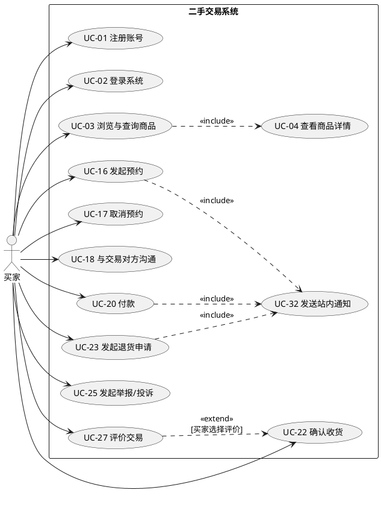

#### 图 2-2 卖家用例图

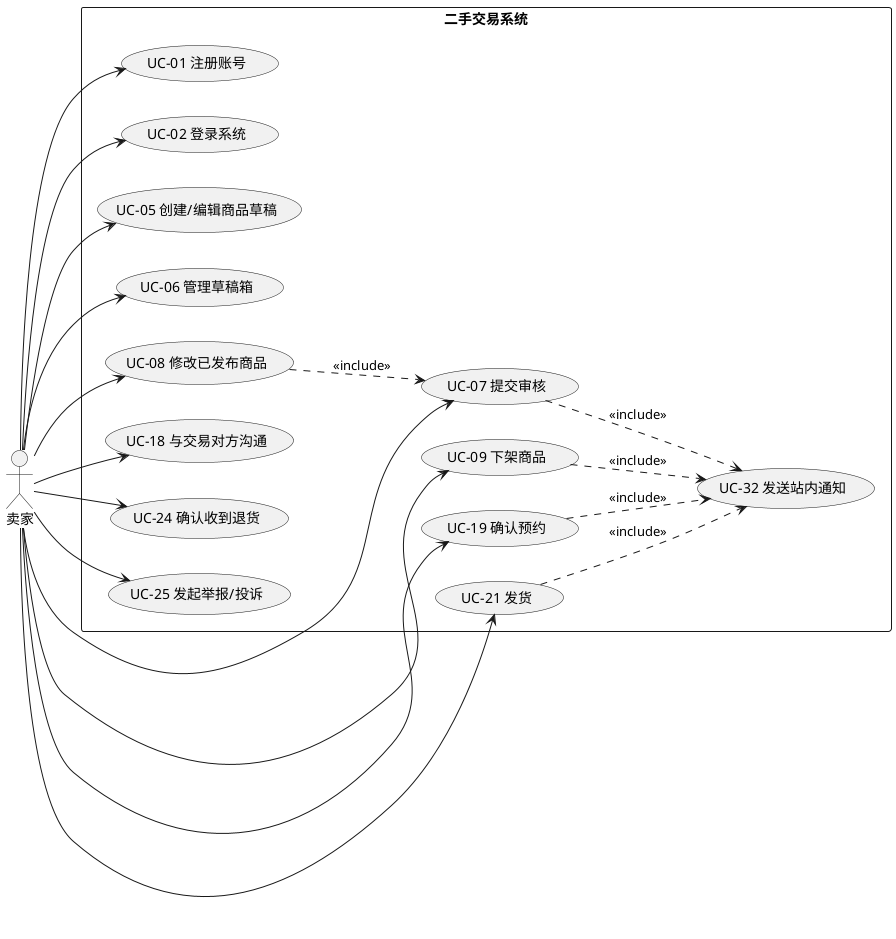

#### 图 2-3 管理员与系统任务用例图

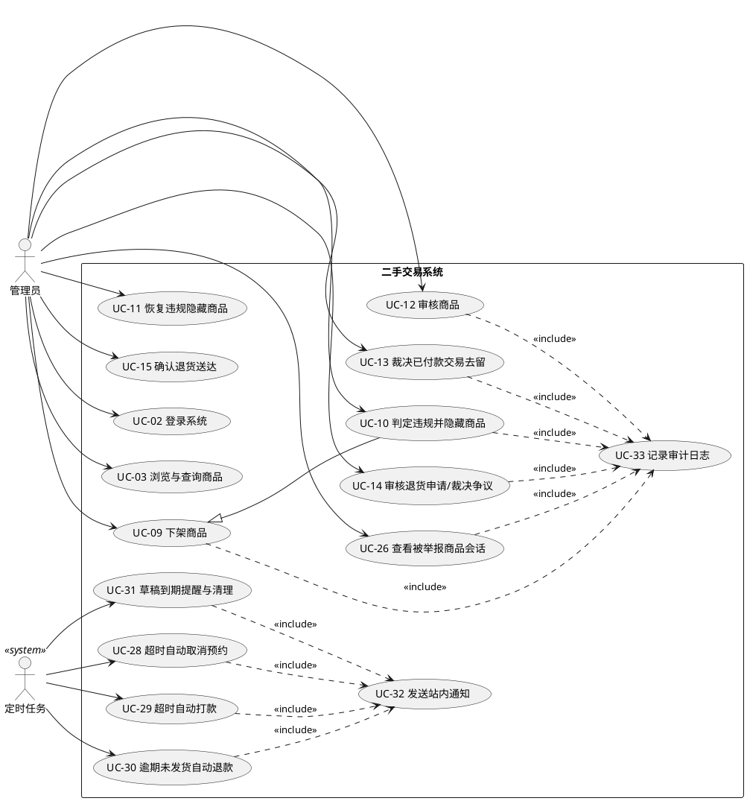

> 图 2-3 中 UC-09 同时被卖家和管理员关联。单张图只画管理员一侧是正常的；总图里把卖家也连上即可。

### 2.5 关键用例规约

以下 6 个用例是答辩最容易被追问的：预约（并发）、审核（状态+驳回）、付款（托管）、退货（多角色协作）、管理员查看私信（权限边界）、修改已发布商品（审核期不可见+回滚）。其余用例按同一模板补即可。

#### UC-16 发起预约

| 项目 | 内容 |
|---|---|
| 用例编号 | UC-16 |
| 参与者 | 买家（主）；定时任务（间接，24 小时未确认时触发 UC-28） |
| 关联需求 | REQ-001、REQ-012、REQ-013、REQ-019 |
| 前置条件 | 买家已登录；商品状态为“已发布”（售罄时余量为 0，直接拒绝）；商品非本人发布；买家无该商品的有效预约 |
| 触发事件 | 买家在商品详情页点击“预约” |
| 后置条件（成功） | 商品余量减 1；新增一条“待卖家确认”预约；通知卖家；若余量变为 0，商品状态改为“售罄”（仍可被搜索） |
| 后置条件（失败） | 余量与预约记录均不变；返回明确错误码与提示 |
| 主成功场景 | 1. 买家提交预约请求（商品 ID、页面令牌）<br>2. 服务端校验：已登录、商品已发布、余量大于 0、非本人商品、无重复有效预约<br>3. 在事务内锁定商品并扣减余量<br>4. 创建预约记录，状态“待卖家确认”<br>5. 向卖家发送站内通知<br>6. 返回预约成功、剩余余量 |
| 扩展/异常流 | 2a. 未登录 → 401，跳转登录页<br>2b. 商品已下架/违规隐藏/待审核 → 409，提示不可预约<br>2c. 余量为 0 或已售罄 → 409，按实际余量提示<br>2d. 买家预约自己发布的商品 → 403<br>2e. 同一买家已有有效预约 → 409，“不能重复预约”<br>3a. 并发扣减失败（版本冲突/条件更新影响行数为 0）→ 409，“页面已过期或余量不足”，客户端 1 秒内刷新<br>5a. 通知失败不影响预约主事务，进入重试队列 |
| 业务规则 | 每次预约数量固定 1 件（假设）；同一买家同一商品最多 1 条有效预约；扣减余量与创建预约在同一事务；用条件更新或乐观锁保证不超卖；以服务端实际余量为准，不信任页面显示 |
| 验收关联 | REQ-001 的 4 个异常用例；REQ-019 的 100 并发、10 轮、账实相符 |

#### UC-12 审核商品

| 项目 | 内容 |
|---|---|
| 用例编号 | UC-12 |
| 参与者 | 管理员（主）；卖家（被通知方） |
| 关联需求 | REQ-008、REQ-009、REQ-026、REQ-025 |
| 前置条件 | 管理员已登录；存在“待审核”的审核申请；该商品当日提交次数不超过 5 |
| 触发事件 | 管理员打开待审核列表并选择一条审核申请 |
| 后置条件（通过） | 新发布：商品变为“已发布”；修改：应用新内容并恢复可见；卖家与管理员均收到发布通知；写审计日志 |
| 后置条件（驳回） | 新发布：商品退回“审核驳回”，驳回理由必填并通知卖家；修改：回滚到修改前版本并恢复可见；写审计日志 |
| 主成功场景 | 1. 管理员查看待审内容与商品历史版本<br>2. 管理员选择“通过”<br>3. 系统校验申请仍为待审核、商品状态未变化<br>4. 应用内容，商品状态转为“已发布”（余量为 0 则“售罄”）<br>5. 通知卖家与管理员<br>6. 记录审核人与时间、审计日志 |
| 扩展/异常流 | 2a. 管理员驳回但未填理由 → 拒绝提交，提示必填<br>2b. 管理员驳回 → 记录理由，新发布退回“审核驳回”；修改类回滚旧版本<br>2c. 同一商品当日第 6 次提交 → 拒绝并提示次日再试<br>2d. 审核期间商品被下架/隐藏 → 申请失效，提示管理员刷新<br>2e. 修改审核期间已有预约 → 提交时已终止并通知买家，审核通过后不恢复 |
| 业务规则 | 修改类审核期间商品对外不可见、不可预约、不参与排序；驳回理由必填；发布后卖家与管理员同时收到通知；审核、驳回、隐藏均写审计日志（REQ-017） |
| 验收关联 | REQ-008、REQ-026 的验收方法 |

#### UC-20 付款（含平台托管）

| 项目 | 内容 |
|---|---|
| 用例编号 | UC-20 |
| 参与者 | 买家（主）；支付渠道（外部系统，模拟）；定时任务（2 小时超时） |
| 关联需求 | REQ-014、REQ-015、REQ-017、REQ-019 |
| 前置条件 | 预约状态为“待付款”；卖家已在 24 小时内确认；当前时间未超过付款截止时间 |
| 触发事件 | 买家在预约详情页点击“付款” |
| 后置条件（成功） | 生成订单；托管记录为“托管中”；预约标记已付款；启动“7 天未发货”计时；通知买卖双方 |
| 后置条件（失败） | 不生成订单，不产生托管记录；预约仍为“待付款”，直到买家重试或 2 小时超时 |
| 主成功场景 | 1. 买家发起支付，服务端校验预约归属、状态、截止时间<br>2. 调用支付渠道（模拟）扣款<br>3. 支付成功回调，服务端校验回调签名与金额<br>4. 创建订单，金额=商品成交价<br>5. 创建托管记录，状态“托管中”，货款不进入卖家账户<br>6. 预约标记已付款；注册发货超时计时器<br>7. 通知买卖双方交易成立 |
| 扩展/异常流 | 1a. 已超时 → 409，预约已由定时任务取消<br>1b. 非本人预约 → 403<br>2a. 渠道扣款失败 → 返回失败，预约不变<br>3a. 回调重复 → 按支付单号幂等处理，不重复建单<br>3b. 回调金额不一致 → 拒绝入账并告警<br>6a. 付款后超过 7 天卖家未发货 → 定时任务触发 UC-30，全额退款 |
| 业务规则 | 先付款、平台托管、确认收货后打款；支付凭证、银行卡号不下发客户端；支付与托管接口必须服务端鉴权（REQ-017）；订单与预约一一对应 |
| 验收关联 | REQ-014、REQ-015 的验收方法；REQ-019 并发支付幂等 |

#### UC-23 发起退货申请（含 UC-14/15/24）

| 项目 | 内容 |
|---|---|
| 用例编号 | UC-23 |
| 参与者 | 买家（主）；管理员（审核/送达确认）；卖家（收货确认）；托管服务（退款） |
| 关联需求 | REQ-016、REQ-010、REQ-015 |
| 前置条件 | 存在已付款、托管中的订单；退货由买家发起；同一订单同一时刻最多 1 条进行中的退货申请 |
| 触发事件 | 买家在订单页点击“申请退货”并填写理由 |
| 后置条件（成功） | 托管货款退回买家；订单状态“已退款”；交易结束；通知买卖双方 |
| 后置条件（失败/关闭） | 交易维持，货款继续按原流程结算；通知双方 |
| 主成功场景 | 1. 买家提交退货理由<br>2. 管理员审核申请，必要时参考双方理由与沟通记录<br>3. 审核通过，退货状态“待买家寄回”，寄回截止时间=审核通过+7 天<br>4. 买家寄回并填写快递单号，状态“已寄回”<br>5. 管理员确认快递送达<br>6. 卖家确认收到退货商品<br>7. 托管服务将货款全额退还买家，订单“已退款”，结束交易 |
| 扩展/异常流 | 2a. 管理员驳回 → 交易维持，通知双方<br>2b. 卖家不同意退货 → 管理员依据双方理由裁决，裁决结果仍走 2/3 步<br>4a. 审核通过后 7 天未提交快递单号 → 视为交易达成，关闭申请、不退款<br>5a. 管理员迟迟未确认送达 → 申请保持“已寄回”，不自动退款（需求未给超时，建议补充）<br>6a. 卖家不确认收货 → 建议管理员可强制确认（需求未写明，待确认） |
| 业务规则 | 退款只能从托管资金出，不能由卖家直接退；退货审核、送达确认、退款均写审计日志；退货期间订单结算冻结 |
| 验收关联 | REQ-016 的验收方法；REQ-010 的“终止交易则退货”分支 |

#### UC-26 查看被举报商品会话

| 项目 | 内容 |
|---|---|
| 用例编号 | UC-26 |
| 参与者 | 管理员（主）；举报人（间接，工单创建者） |
| 关联需求 | REQ-005、REQ-017、REQ-006 |
| 前置条件 | 管理员已登录；存在针对该商品的举报/投诉工单；工单状态为处理中；被查看会话确属该工单涉及的买家与卖家 |
| 触发事件 | 管理员从工单进入“查看沟通记录” |
| 后置条件 | 管理员获得只读会话内容；审计日志新增一条记录（操作人、工单、商品、会话、时间） |
| 主成功场景 | 1. 管理员打开工单<br>2. 系统校验管理员角色、工单存在、工单商品与会话商品一致、会话双方与工单双方一致<br>3. 返回该商品下该买卖双方的会话消息（只读）<br>4. 记录审计日志<br>5. 管理员依据记录判断是否违规，转入 UC-10 或 UC-13 |
| 扩展/异常流 | 2a. 无工单或工单已关闭 → 403<br>2b. 试图查看其他商品/其他用户的会话 → 403<br>2c. 试图导出、复制、转发 → 前端不提供入口，服务端不提供导出接口<br>4a. 审计写入失败 → 拒绝返回消息内容（审计优先） |
| 业务规则 | 只读、不可导出、范围仅限工单对应商品下的买卖双方会话；查看行为 100% 留痕；消息留存 30 天（与“退货可查”存在时间冲突，见第 8 节） |
| 验收关联 | REQ-005、REQ-017 的验收方法 |

#### UC-08 修改已发布商品

| 项目 | 内容 |
|---|---|
| 用例编号 | UC-08 |
| 参与者 | 卖家（主）；管理员（审核）；买家（预约被终止时被通知） |
| 关联需求 | REQ-009、REQ-008、REQ-026、REQ-019 |
| 前置条件 | 商品状态为“已发布”或“售罄”；操作者为该商品卖家；当日提交次数未超限 |
| 触发事件 | 卖家在商品管理页点击“修改”并提交 |
| 后置条件（提交） | 生成一条“修改”类型的审核申请；保存修改前版本快照；商品状态“待审核”，对外不可见；该商品所有有效预约被终止、余量恢复、买家收到通知 |
| 后置条件（通过） | 应用新内容并生成新版本；商品恢复可见（余量为 0 则“售罄”）；通知卖家 |
| 后置条件（驳回） | 回滚到修改前版本并恢复可见；通知卖家并显示驳回理由 |
| 主成功场景 | 1. 卖家编辑并提交修改<br>2. 系统校验归属、状态、当日提交次数<br>3. 保存旧内容快照，创建“修改”审核申请<br>4. 商品转为“待审核”，从买家查询结果中消失<br>5. 终止该商品有效预约，恢复余量并通知受影响买家<br>6. 管理员审核（UC-12） |
| 扩展/异常流 | 2a. 非本人商品 → 403<br>2b. 商品已下架/隐藏 → 409，提示先重新提交审核<br>2c. 当日第 6 次 → 拒绝<br>5a. 该商品存在已付款订单 → 订单继续履约，不受修改审核影响；仅终止未付款的有效预约（假设，见 A-18）<br>6a. 驳回后回滚失败（快照缺失）→ 告警并保持不可见，人工处理 |
| 业务规则 | 审核期间商品不可见、不可预约、不参与排序；预约终止必须通知买家“需重新预约”；修改审核不通过绝不覆盖线上旧版本 |
| 验收关联 | REQ-009、REQ-026 的验收方法 |

#### UC-03 的补充：综合排序（内部业务规则，不单列用例）

排序是“浏览与查询商品”的内部步骤，不画成独立用例，但类图和顺序图要能支撑：

| 项目 | 规则（REQ-011） | 建模落点 |
|---|---|---|
| 匹配度 | 关键词与标题、描述的匹配得分，归一化到 0–100 | 查询服务计算，不持久化 |
| 近期评价 | 近 30 天已完成交易买家的评分均值；无评价取分类均值 | 评价类 + 商品分类.评价均值 |
| 浏览量 | 近 30 天详情页 UV，同一用户 24 小时内去重 | 浏览记录类 |
| 销量 | 近 30 天已完成交易件数 | 商品.近30日销量（由订单聚合） |
| 加权 | 匹配度 50% + 评价 20% + 浏览量 10% + 销量 20%，降序 | 排序权重配置（可配置） |
| 并列 | 总分相同按发布时间倒序 | 商品.发布时间 |
| 缺数据 | 无浏览量/销量取 0；售罄商品仍参与搜索与排序 | 商品状态=售罄不排除 |

类图上不需要为“搜索结果”建实体类，它是查询返回的 DTO；权重、评价、浏览明细才是需要持久化的对象。

---

## 3. 静态模型：类图

### 3.1 从需求中抽取名词

| 名词（来源） | 建模结论 | 说明 |
|---|---|---|
| 买家、卖家、管理员 | 角色枚举 + 用例参与者 | 不建三个用户子类，见 1.3 |
| 账号、用户名、手机号、密码 | 类“账号” | 密码只存哈希；用户名、手机号唯一 |
| 商品、标题、描述、价格、库存、余量 | 类“商品” | 余量是并发扣减的核心属性 |
| 分类、品牌 | 类“商品分类” | 分类还承载“无评价时取分类均值” |
| 商品图片 | 类“商品图片” | 图片 URL 存对象存储 |
| 草稿、草稿箱 | “商品”的状态 + 属性 | 草稿箱是 `状态=草稿` 的查询视图；10 篇/30 天是约束 |
| 审核、驳回理由、审核人 | 类“审核申请” | 新发布和修改共用一个审核流，用“类型”区分 |
| 商品版本、修改前内容 | 类“商品版本” | 修改驳回时回滚用；与并发用的“版本号”不是一回事 |
| 预约、预约时间、确认时间 | 类“预约” | 独立对象，有状态与超时 |
| 订单、付款时间、发货时间 | 类“订单” | 付款成功后生成，与预约一一对应 |
| 货款、托管、打款、退款 | 类“托管记录” | 资金状态与订单履约状态分开 |
| 支付单、支付渠道 | 类“支付记录” | 可选；用于回调幂等与对账 |
| 退货申请、理由、快递单号 | 类“退货申请” | 一条订单可有多条历史申请，同一时刻最多一条进行中 |
| 消息、文字、图片 | 类“消息” | 消息类型枚举 |
| 会话、买卖双方沟通 | 类“会话” | 按（商品，买家，卖家）唯一确定 |
| 举报、投诉、工单 | 类“举报工单” | 需求只提“有举报时”，但管理员查看私信必须有工单凭证 |
| 通知、站内消息 | 类“通知” | 与聊天消息区分，不参与会话 |
| 审计日志、操作记录 | 类“审计日志” | 横切类，所有敏感操作用 |
| 评价、评分、近期评价 | 类“评价” | 排序的数据来源；需求未定义评价入口，列为派生 |
| 浏览量、UV | 类“浏览记录” + 商品聚合属性 | 24 小时去重需要明细 |
| 销量 | 商品聚合属性 | 近 30 天完成交易件数，可由订单聚合 |
| 排序权重 | 类“排序权重配置” | 0.5/0.2/0.1/0.2，可配置 |
| 收货地址、姓名、手机号 | 类“收货地址” | REQ-017 隐含；地址只返回到区县 |
| 24 小时、2 小时、7 天、30 天 | 状态机时间事件/属性 | 不是类，是 `after(...)` 与截止时间字段 |
| 页面令牌、乐观锁版本号 | 属性 | 并发控制，不单独建业务类 |

### 3.2 核心类清单

#### 用户与权限

| 类 | 职责 | 关键属性 | 关键操作 | 依据 |
|---|---|---|---|---|
| 账号 Account | 登录主体与权限载体 | 账号 ID、用户名、手机号、密码哈希、失败次数、锁定截止时间、状态 | 注册、登录、校验权限、记录登录失败 | REQ-003/004/027 |
| 角色 Role | 三类角色枚举 | 买家、卖家、管理员 | — | REQ-004 |
| 收货地址 Address | 买家收货信息 | 收件人、手机号、省市区、详细地址 | 增删改、脱敏输出 | REQ-017（隐含） |

#### 商品与审核

| 类 | 职责 | 关键属性 | 关键操作 | 依据 |
|---|---|---|---|---|
| 商品 Product | 商品主体、库存与状态 | 标题、描述、价格、总库存、剩余余量、状态、版本号、最后保存时间、发布时间 | 是否可预约、扣减余量、恢复余量、提交审核、下架、隐藏、恢复 | REQ-001/007~013/025 |
| 商品分类 Category | 分类与兜底评分 | 名称、父分类、评价均值 | — | REQ-011 |
| 商品图片 ProductImage | 商品图 | URL、排序 | — | REQ-006/007 |
| 审核申请 ReviewApplication | 一次审核的内容与结论 | 类型（新发布/修改）、待审内容快照、状态、驳回理由、提交时间、审核人、审核时间 | 提交、通过、驳回 | REQ-008/009/026 |
| 商品版本 ProductVersion | 线上内容快照 | 版本号、内容快照、生效时间 | 生成快照、回滚 | REQ-009/026 |
| 状态变更记录 StateChangeLog | 商品状态流转留痕 | 变更前状态、变更后状态、操作人、时间、原因 | 记录 | REQ-025 |

#### 交易与资金

| 类 | 职责 | 关键属性 | 关键操作 | 依据 |
|---|---|---|---|---|
| 预约 Reservation | 购买意向与库存占用 | 数量、状态、创建时间、确认时间、付款截止时间、版本号 | 创建、取消、卖家确认、超时取消 | REQ-001/012/014/019 |
| 订单 Order | 成交后的履约与结算主体 | 成交金额、状态、付款/发货/确认收货时间、物流单号、版本号 | 支付、发货、确认收货、关闭 | REQ-014/015/016 |
| 托管记录 EscrowRecord | 平台资金托管状态 | 应收、实收、已打款金额、状态、托管/打款/退款时间 | 托管、打款给卖家、退款给买家 | REQ-015/016 |
| 支付记录 Payment | 支付流水与回调幂等 | 支付单号、金额、支付时间、渠道、状态 | 创建、回调确认 | REQ-014/015 |
| 退货申请 ReturnRequest | 退货全流程 | 理由、状态、审核结果、快递单号、寄回截止时间、送达/收货确认 | 提交、审核、填单号、确认送达、确认收货、超期关闭 | REQ-016 |

#### 沟通与监管

| 类 | 职责 | 关键属性 | 关键操作 | 依据 |
|---|---|---|---|---|
| 会话 Conversation | 某商品下买卖双方的消息线程 | 创建时间 | 发送消息、只读查询 | REQ-005/006 |
| 消息 Message | 单条聊天消息 | 类型（文字/图片）、内容、发送时间、已读 | — | REQ-006 |
| 举报工单 ComplaintTicket | 管理员查看私信的授权凭证 | 举报人、被举报人、商品、理由、状态、处理结果 | 创建、处理、关闭 | REQ-005（派生） |
| 通知 Notification | 站内业务通知 | 类型、内容、是否已读、时间 | 发送、标记已读 | REQ-008 等多处 |
| 审计日志 AuditLog | 敏感操作留痕 | 操作人、操作类型、目标对象、时间、结果、IP | 记录 | REQ-017 |

#### 查询支撑

| 类 | 职责 | 关键属性 | 关键操作 | 依据 |
|---|---|---|---|---|
| 评价 Review | 交易评分 | 评分、内容、时间 | 评分 | REQ-011（派生） |
| 浏览记录 ViewRecord | 商品浏览量明细与 UV 去重 | 用户、商品、浏览时间 | 记录 | REQ-011（派生） |
| 排序权重配置 ScoreConfig | 综合排序权重 | 匹配度 0.5、评价 0.2、浏览量 0.1、销量 0.2 | 读取、更新 | REQ-011 |

### 3.3 领域类图

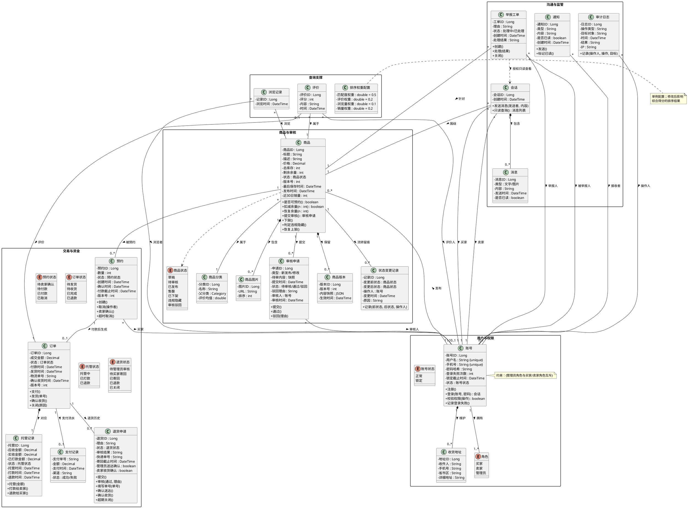

> 如果渲染后线条太乱，把图拆成三张：**用户+商品与审核**、**交易与资金**、**沟通监管+查询支撑**，每张保留 7~9 个类即可。拆图时跨图关系用注释说明，不要删多重性。

### 3.4 关系与多重性

| 关系 | 多重性 | UML 类型 | 说明与约束 |
|---|---|---|---|
| 账号 — 角色 | 1 : 1..* | 关联 | 普通账号至少 1 个角色；管理员角色与买卖角色互斥 |
| 账号 — 收货地址 | 1 : 0..* | 组合 | 地址随账号删除；也可改为普通关联保留历史 |
| 账号 — 商品（发布） | 1 : 0..* | 关联 | 卖家发布；管理员不发布商品 |
| 商品 — 商品分类 | * : 1 | 关联 | 分类可有多级，父分类自关联 |
| 商品 — 商品图片 | 1 : 0..* | 组合 | 图片随商品删除 |
| 商品 — 审核申请 | 1 : 0..* | 关联 | 新发布 1 条；修改可多次，受每日 5 次限制 |
| 商品 — 商品版本 | 1 : 0..* | 组合 | 每次审核通过生成新版本；驳回回滚到上一版本 |
| 商品 — 状态变更记录 | 1 : 0..* | 关联 | REQ-025 要求每次状态流转记录操作人与时间；记录不可修改 |
| 商品 — 预约 | 1 : 0..* | 关联 | 同一买家最多 1 条有效预约（约束） |
| 预约 — 账号（买家） | * : 1 | 关联 | 一个买家可有多条预约 |
| 预约 — 订单 | 1 : 0..1 | 关联 | 付款成功后生成；未付款无订单 |
| 订单 — 托管记录 | 1 : 1 | 组合 | 托管记录生命周期随订单；资金状态独立于订单状态 |
| 订单 — 支付记录 | 1 : 0..1 | 关联 | 成功后 1 条；失败/重试可用多流水，简化画 1 条 |
| 订单 — 退货申请 | 1 : 0..* | 关联 | 历史可多条；同一时刻最多 1 条进行中（约束） |
| 会话 — 商品 | * : 1 | 关联 | 每个（商品，买家，卖家）组合唯一一条会话 |
| 会话 — 账号（买家/卖家） | * : 1 | 关联 | 两条不同角色的关联，需写明角色名 |
| 会话 — 消息 | 1 : 0..* | 组合 | 消息随会话删除；留存 30 天后归档/清理 |
| 举报工单 — 商品 | * : 1 | 关联 | 一个商品可被多次举报 |
| 举报工单 — 账号 | * : 1 | 关联 | 举报人与被举报人两条关联 |
| 举报工单 — 会话 | 1 : 0..* | 依赖（虚线） | 不是数据归属，而是“凭工单获得只读权限” |
| 通知 — 账号 | * : 1 | 关联 | 通知接收者 |
| 审计日志 — 账号 | * : 1 | 关联 | 操作人；系统任务可空 |
| 评价 — 订单 | 0..1 : 1 | 关联 | 一个订单最多一条评价 |
| 评价 — 商品/账号 | * : 1 | 关联 | 用于计算商品近 30 天评分均值 |
| 浏览记录 — 商品/账号 | * : 1 | 关联 | 24 小时内同一用户同一商品只计 1 次 UV |
| 排序权重配置 | 1 | 独立类 | 单例；权重可配置 |

### 3.5 关键建模决策（答辩重点）

1. **用“角色关联”而不是“三个用户子类”**。理由见 1.3：一人可兼买卖、管理员互斥、后续可扩展角色。用例图仍用三个参与者，是视角不同，不是模型矛盾。
2. **草稿不单独建类，而是商品的“草稿”状态**。这样草稿提交审核、发布、驳回都围绕同一个商品 ID 流转，不会出现“草稿变成商品要换 ID”的尴尬。草稿箱是查询：`卖家=当前用户 AND 状态∈{草稿, 审核驳回} ORDER BY 最后保存时间 DESC`，容量 10、保留 30 天是约束/定时任务。
3. **预约与订单分离**。预约表达“占用库存的购买意向”，订单表达“付款后的履约与结算”。付款成功才创建订单，两者 1:0..1。如果把两者合成一个“订单”，会出现未付款也占用订单号、取消逻辑与退款逻辑混在一起的问题。
4. **审核申请与商品版本分离**。`审核申请`保存“待审的新内容”和审核结论；`商品版本`保存“线上旧内容”，用于修改被驳回时回滚。注意两个“版本号”不是一回事：商品上的 `版本号` 是乐观锁并发令牌，`商品版本` 是业务内容快照。顺序图 SD-04 会把这条讲清楚。
5. **托管记录独立于订单**。订单状态回答“货到哪了”，托管状态回答“钱在哪”。退货、超时未发货、确认收货都只改托管记录，不动订单金额，便于对账。
6. **会话不建“管理员会话”子类**。管理员查看是**权限行为**，不是新的数据实体；用“举报工单 + 审计日志”表达授权与留痕，避免把只读权限误画成数据关系。
7. **排序相关类属于查询支撑**。评价、浏览记录、排序权重配置不是交易主流程的实体，但 REQ-011 的排序公式离不开它们；放在单独包中，避免主类图失焦。
8. **审计日志是横切类**。它不属于某个业务聚合，关联到操作人即可；具体“操作类型”用枚举/字符串，避免为每种敏感操作建一个子类。

### 3.6 分析类（BCE）对照

若课程要求“分析类图”，按边界类—控制类—实体类三层给出，顺序图可直接复用这些名字：

| 层次 | 类 | 对应用例 |
|---|---|---|
| 边界 Boundary | 登录/注册页、商品列表页、商品详情页、预约/订单页、卖家工作台、草稿箱页、审核管理页、会话页、退货页、通知中心 | UC-01~27 |
| 控制 Control | 认证服务、商品服务、审核服务、预约服务、订单服务、托管服务、退货服务、消息服务、监管服务、通知服务、调度服务 | UC-01~31 |
| 实体 Entity | 账号、角色、商品、审核申请、商品版本、状态变更记录、预约、订单、托管记录、退货申请、会话、消息、举报工单、通知、审计日志、评价、浏览记录、排序权重配置 | 全部 |

控制类只做“用例编排 + 事务边界 + 权限校验”，业务规则（余量、状态迁移）放在实体类；这是顺序图里“服务调实体方法”的画法依据。

## 4. 动态模型

动态模型回答“对象之间怎么协作、状态怎么变”。本文的顺序图是**分析级**：参与者是 Actor + 应用服务 + 实体，省略了 Controller/Repository 的逐层调用；如果课程要求设计级顺序图，在 Actor 与服务之间插入“边界类（页面）”，在服务与数据库之间插入“仓储类”，消息内容不变。

统一命名：

- 服务：`预约服务`、`订单服务`、`托管服务`、`退货服务`、`审核服务`、`商品服务`、`监管服务`、`通知服务`、`调度服务`
- 实体：`商品`、`预约`、`订单`、`托管记录`、`退货申请`、`审核申请`、`会话`、`审计日志`
- 外部：`支付渠道（模拟）`

### 4.1 顺序图索引

| 图号 | 场景 | 主要验证的需求 | 关键点 |
|---|---|---|---|
| SD-01 | 发起预约 | REQ-001/013/019 | 条件更新防超卖、重复预约、旧页面 |
| SD-02 | 卖家确认 → 付款 → 托管 | REQ-012/014/015 | 24h/2h 时限、订单与托管生成 |
| SD-03 | 确认收货 → 打款 | REQ-015 | 托管资金流向、自动打款 |
| SD-04 | 修改已发布商品重审 | REQ-009/026 | 快照、不可见、终止预约、回滚 |
| SD-05 | 草稿双窗口保存 | REQ-007/019 | 令牌失效、版本冲突、1 秒刷新 |
| SD-06 | 退货 | REQ-016 | 管理员/买家/卖家三方确认、退款 |
| SD-07 | 管理员查看被举报会话 | REQ-005/017 | 工单授权、只读、审计 |
| SD-08 | 定时任务扫描 | REQ-007/012/015 | 时间事件补偿业务状态 |

### 4.2 顺序图

#### 图 4-1 SD-01 发起预约（并发与重复校验）

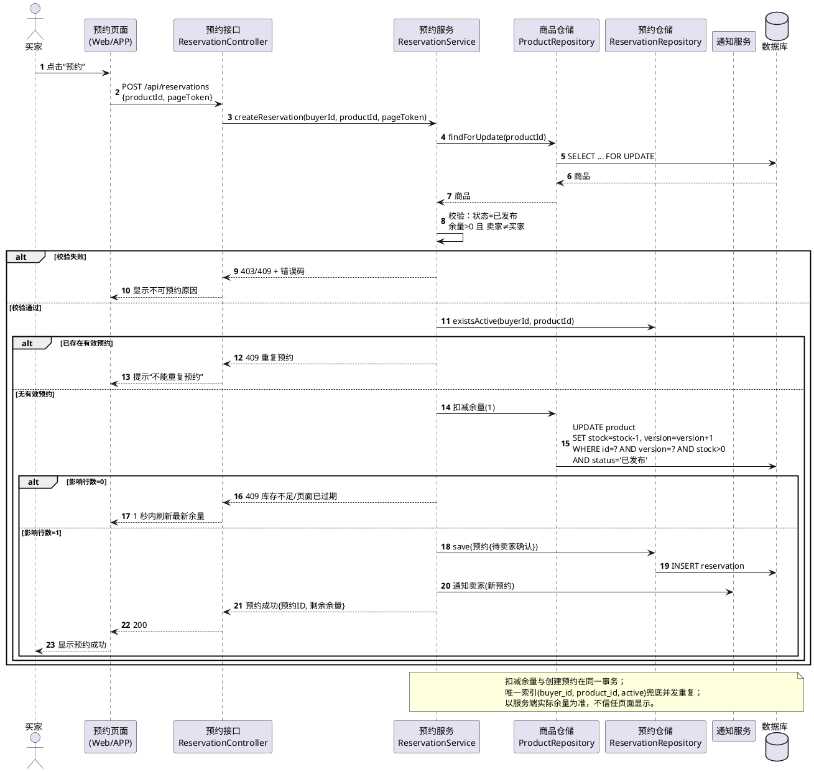

要点：

- **两层并发控制**：数据库条件更新（或 `SELECT ... FOR UPDATE`）防超卖；唯一索引/幂等键防同一买家并发重复预约。REQ-019 要求 100 并发成功 1 条、重复 0 条，正好对应这两层。
- **最后一件的先后**：并发请求由数据库行锁/条件更新串行化，先获得锁并成功扣减者胜出，后到者收到“余量不足”错误；这实现了 REQ-001 的“按预约时间先后判定”，不依赖客户端时间戳。
- **旧页面**：请求带 `pageToken` 与版本号，服务端以实际状态为准；失败返回明确错误码，客户端 1 秒内刷新。
- `通知服务` 失败不回滚预约，用重试/消息表保证最终通知。

#### 图 4-2 SD-02 卖家确认与付款托管

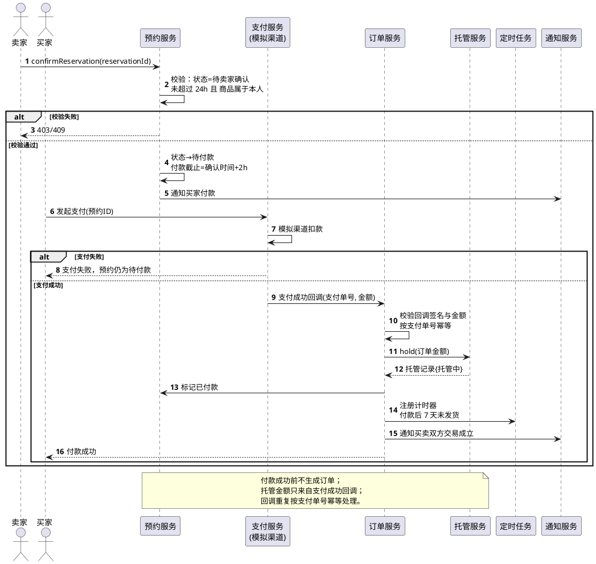

> 图中“买家直接与支付服务交互”是为了突出资金流；设计级可插入“收银台页面”和“支付回调接口”。支付渠道是模拟的，不能画成真实第三方。

#### 图 4-3 SD-03 确认收货与打款

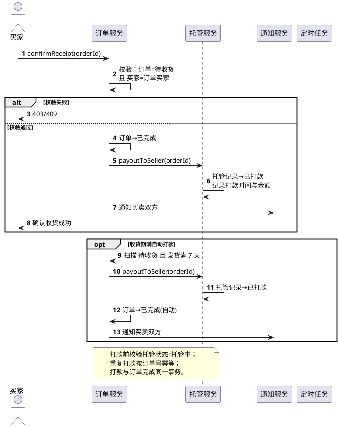

**待确认**：自动打款的 7 天从“发货时间”还是“付款时间”起算，需求没有写死；图中按“发货后 7 天”画，答辩时要说明这是假设。

#### 图 4-4 SD-04 修改已发布商品并重新审核

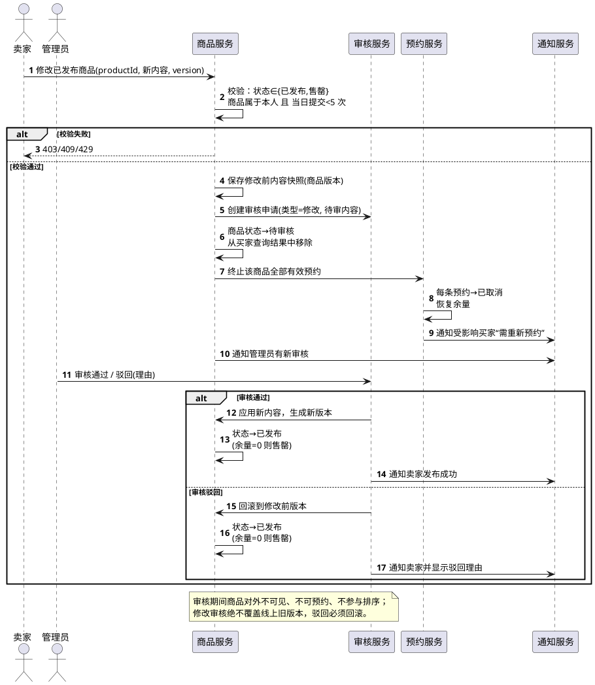

> 若修改前商品是“售罄”，回滚后应回到“售罄”而不是“已发布”；图中用注释说明，状态机 SM-01 也保留这条分支。

#### 图 4-5 SD-05 草稿双窗口并发保存

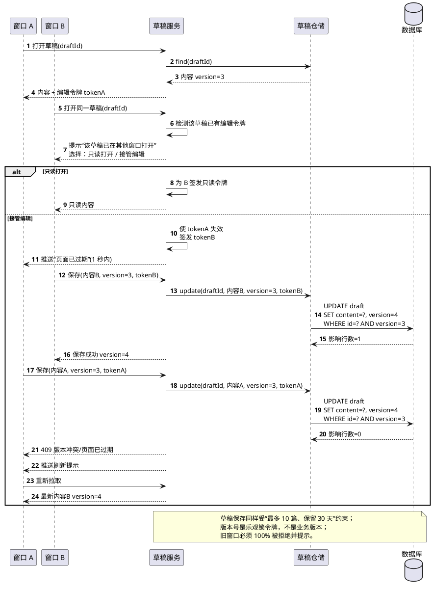

> 页面关闭后编辑令牌失效；即使用户忽略提示继续提交，服务端仍以版本号与令牌双重校验拒绝写入，轮询/推送只负责让旧页面尽快刷新。

#### 图 4-6 SD-06 退货流程

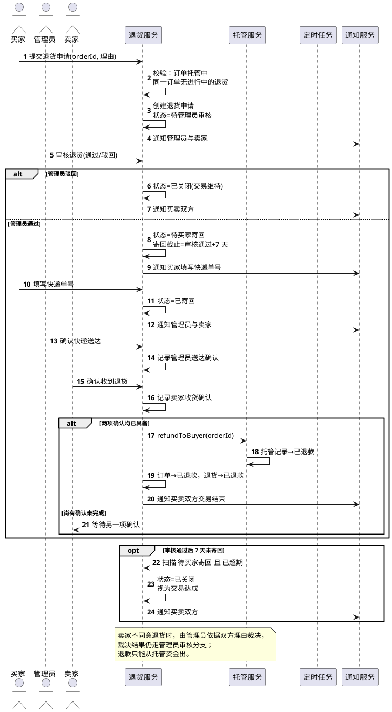

#### 图 4-7 SD-07 管理员查看被举报商品会话

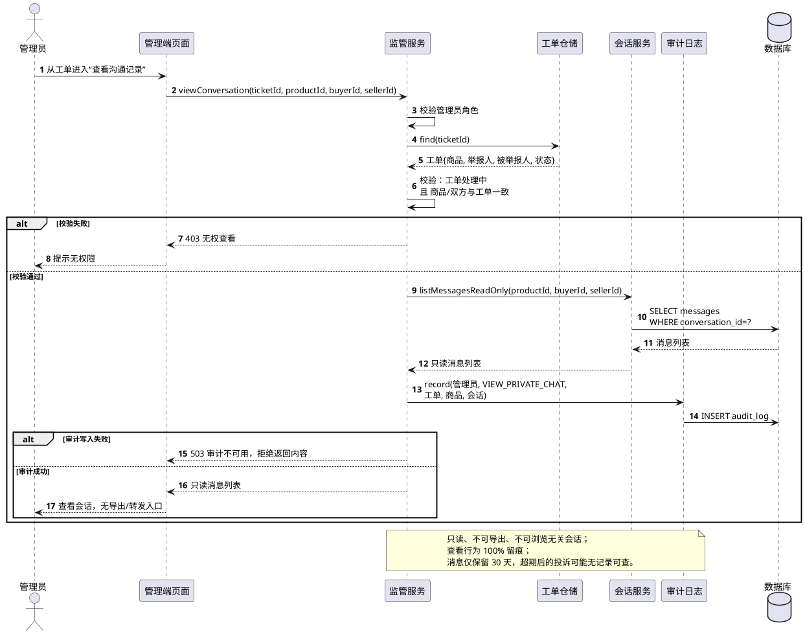

#### 图 4-8 SD-08 定时任务扫描

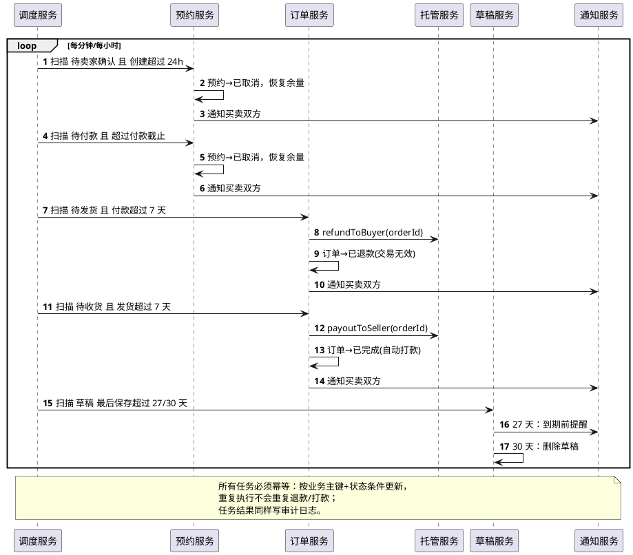

### 4.3 活动图

活动图适合讲“跨角色的业务流程”，与报告里的流程图相比，重点是**泳道**：谁在什么阶段做什么。状态机图适合讲“单个对象的状态”，两者不要互相替代。

#### 图 4-9 AD-01 预约到交易完成

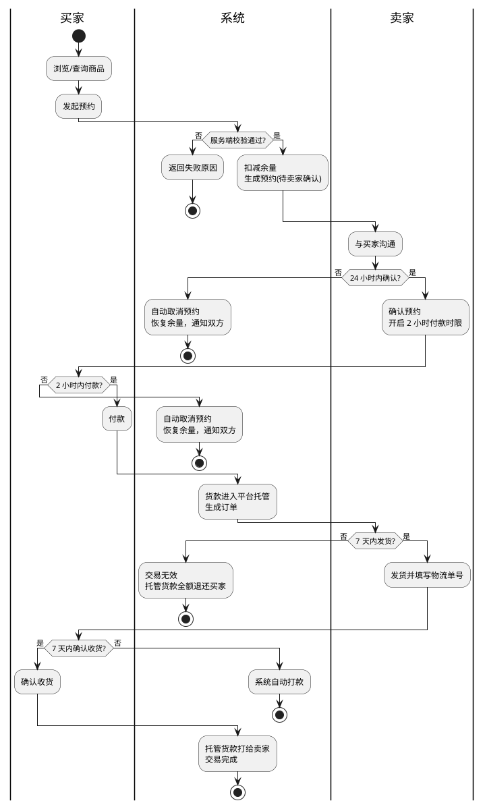

#### 图 4-10 AD-02 退货流程

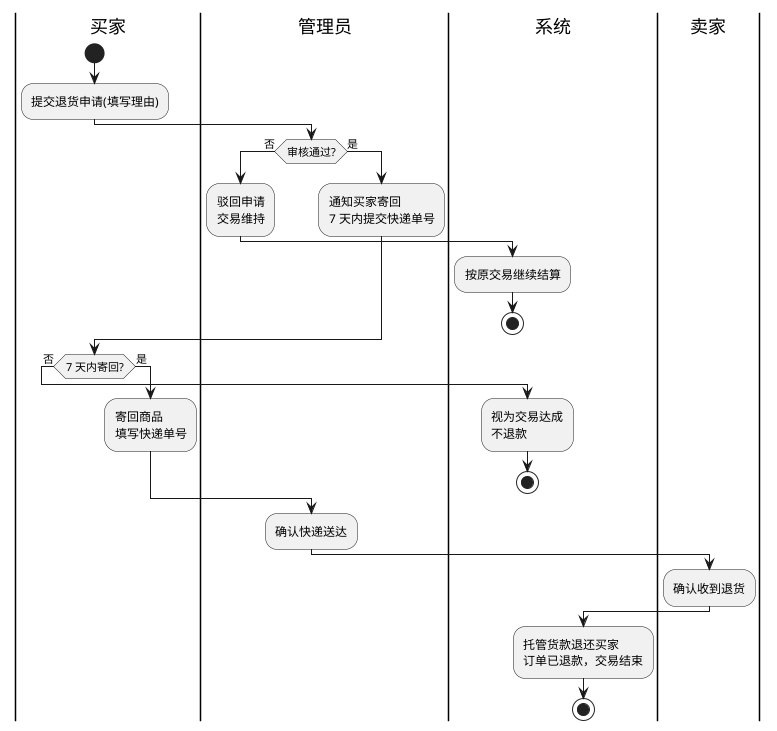

**卖家不同意退货**不是一条独立泳道分支，而是管理员审核时的输入：管理员参考双方理由裁决，裁决结果仍走“通过/驳回”。在活动图中用注释标在管理员审核旁即可，不必再画一条重复流程。

### 4.4 状态机图

状态机图是最能体现本次需求“状态流转 + 超时”的图。画的时候注意三点：

1. **时间事件**写成 `after(24 小时)`，不要写成普通事件；
2. **守卫条件**写在方括号里，如 `[卖家在 24h 内确认]`；
3. **进入动作**写在 `/` 后面，如 `/ 余量+1，通知双方`。

#### 图 4-11 SM-01 商品状态机

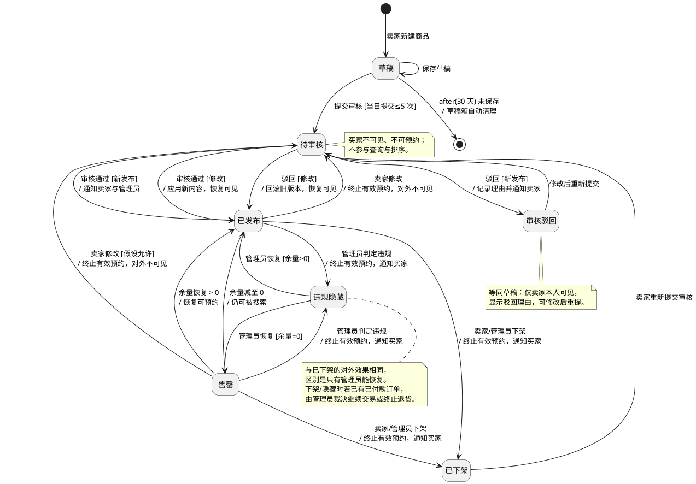

**易错点**：新发布被驳回进入“审核驳回”；已发布商品修改被驳回**不是**进入“审核驳回”，而是回滚旧版本回到“已发布/售罄”。两者在需求里都叫“驳回”，但目标状态不同（REQ-026）。

#### 图 4-12 SM-02 预约状态机

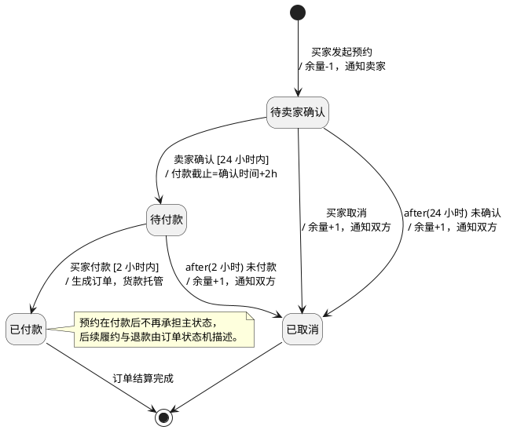

#### 图 4-13 SM-03 订单状态机

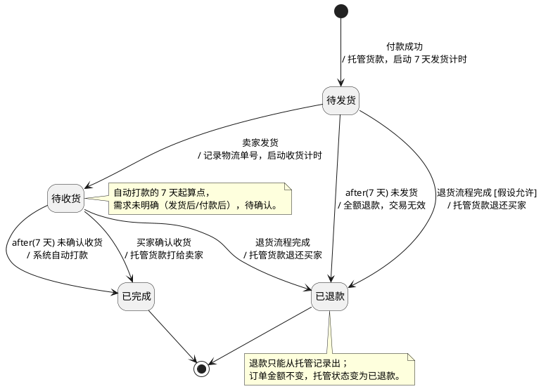

#### 图 4-14 SM-04 退货状态机

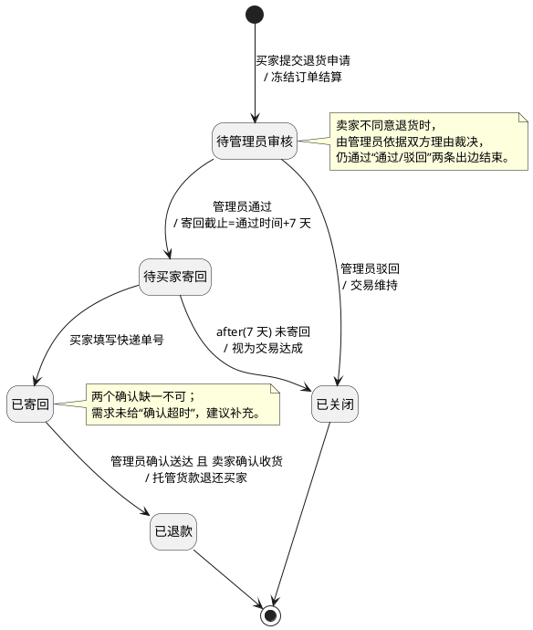

#### 图 4-15 SM-05 账号锁定状态机（可选）

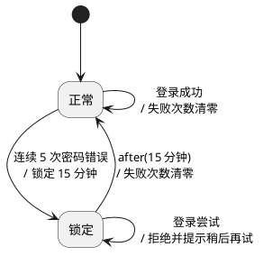

### 4.5 状态机与需求对照

| 状态机 | 状态数 | 关键时间事件 | 需求依据 |
|---|---|---|---|
| SM-01 商品 | 7 | 草稿 30 天清理；审核无超时（需求未定） | REQ-007/008/009/010/025/026 |
| SM-02 预约 | 4 | 24 小时未确认；2 小时未付款 | REQ-001/012/014 |
| SM-03 订单 | 4 | 付款后 7 天未发货；发货后 7 天未确认 | REQ-015/016 |
| SM-04 退货 | 5 | 审核通过后 7 天未寄回 | REQ-016 |
| SM-05 账号 | 2 | 锁定 15 分钟 | REQ-027 |

> 审核本身没有超时要求，REQ-007 的“30 天”只针对草稿；不要想当然给“待审核”加超时。

## 5. 架构模型

### 5.1 分层包图

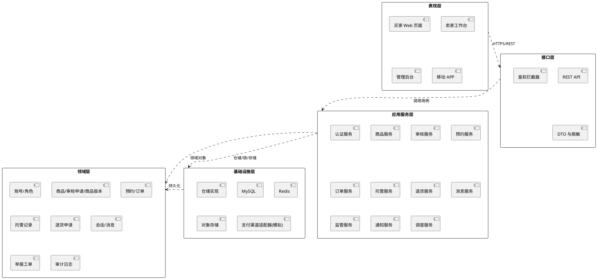

分层依赖只能向下：表现层不直接访问数据库，领域层不依赖 Web 框架。REQ-017 的“敏感操作不能在本地完成”在包图上的体现就是：**所有鉴权在接口层与应用服务层完成，表现层不承载权限判断**。

### 5.2 组件图

```plantuml
@startuml 图5-2 组件图
package "客户端" {
  component "Web 前端\n(桌面网站)" as Web
  component "移动 APP" as App
}

package "接入层" {
  component "API 网关/反向代理\nHTTPS" as GW
}

package "业务组件" {
  [认证与权限组件] as Auth
  [商品与审核组件] as Prod
  [预约与交易组件] as Trade
  [资金托管组件] as Escrow
  [沟通与监管组件] as Msg
  [通知组件] as Notif
  [定时任务组件] as Sched
}

package "基础设施" {
  database "MySQL" as DB
  component "Redis\n缓存/分布式锁/会话" as Redis
  component "对象存储\n商品图片" as OSS
  component "支付渠道适配器\n(模拟)" as Pay
}

Web --> GW : HTTPS/REST
App --> GW : HTTPS/REST
GW --> Auth
GW --> Prod
GW --> Trade
GW --> Msg

Auth --> Redis : 会话/令牌
Prod --> DB
Prod --> OSS
Trade --> DB
Trade --> Redis : 锁/幂等键
Trade ..> Escrow : 托管/退款
Trade ..> Notif : 状态通知
Prod ..> Notif : 审核结果
Msg --> DB
Msg ..> Notif
Sched --> DB
Sched ..> Trade : 超时取消/自动结算
Sched ..> Prod : 草稿清理
Escrow --> DB
Escrow ..> Pay : 扣款/退款(模拟)
@enduml
```

### 5.3 部署图

```plantuml
@startuml 图5-3 部署图
node "买家/卖家设备\n(浏览器或手机 APP)" as Client
node "CDN\n静态资源" as CDN
node "Nginx / API 网关\n(HTTPS 终结)" as GW

node "应用服务器集群" as Cluster {
  component "业务服务\n认证/商品/预约/交易/托管/监管" as Biz
  component "定时任务服务" as Sched
}

node "MySQL 主从集群" as DB <<database>>
node "Redis 集群" as Redis <<cache>>
node "对象存储" as OSS
node "支付渠道(模拟)" as Pay <<external>>

Client --> CDN : HTTPS 静态资源
Client --> GW : HTTPS API / WebSocket 推送
GW --> Biz : 内网 HTTP
Biz --> DB : JDBC
Biz --> Redis : 缓存/锁
Biz --> OSS : 图片上传/读取
Sched --> DB : 定时扫描
Sched --> Redis : 分布式任务锁
Biz ..> Pay : 支付/退款
@enduml
```

部署图要能回答三个非功能需求：

- **REQ-017**：客户端到网关全链路 HTTPS；业务服务在服务端完成鉴权与审计；数据库只在内网。
- **REQ-018**：Web 与 APP 两个客户端共用同一套 API，数据一致性由服务端保证，不靠客户端同步。
- **REQ-019**：Redis 提供分布式锁/幂等键，MySQL 提供事务与乐观锁；定时任务多实例时用 Redis 锁防重复执行。

### 5.4 非功能需求的 UML 落点

| 需求 | 落在哪些模型元素 | 说明 |
|---|---|---|
| REQ-017 前后端分离与敏感数据 | 包图：表现层/接口层/服务层；组件图：认证、审计；部署图：HTTPS、网关、内网数据库；类：审计日志；顺序图 SD-07 | 脱敏在 DTO 层完成，密码只存哈希；敏感接口 401/403 与审计是横切约束 |
| REQ-018 多端支持 | 组件图：Web 前端 + 移动 APP 共用 API；部署图：CDN/网关 | 功能清单在两端一致；5 秒同步是客户端与服务端推送机制，不是新类 |
| REQ-019 并发与一致性 | 类：商品/预约/草稿的版本号；顺序图 SD-01/SD-05；状态机守卫；部署图 Redis 锁 | 乐观锁 + 页面令牌 + 条件更新；冲突返回明确错误码 |
| REQ-027 登录失败锁定 | 状态机 SM-05；类：账号的失败次数/锁定截止时间 | 5 次失败锁 15 分钟是状态机，不是普通属性判断 |
| REQ-007 草稿保留 | 状态机 SM-01 的 `after(30 天)`；调度服务 | 27 天提醒、30 天删除 |

---

## 6. 需求到模型的追踪矩阵

### 6.1 追踪矩阵

| 需求 | 用例 | 核心类 | 动态图 | 说明 |
|---|---|---|---|---|
| REQ-001 商品预约 | UC-16、UC-17 | 商品、预约 | SD-01、SM-02、AD-01 | 并发、重复、最后一件、旧页面 |
| REQ-003 注册登录 | UC-01、UC-02 | 账号、角色 | SM-05 | 管理员预置、不开放注册 |
| REQ-004 角色权限 | UC-01、UC-02 及全部用例 | 账号—角色关联 | 类图约束 | 买卖可兼任、管理员互斥 |
| REQ-005 管理员监管 | UC-25、UC-26 | 举报工单、会话、消息、审计日志 | SD-07 | 工单触发、只读、留痕 |
| REQ-006 买卖沟通 | UC-18 | 会话、消息 | 可选顺序图 | 文字/图片、留存 30 天 |
| REQ-007 草稿与草稿箱 | UC-05、UC-06、UC-31 | 商品（草稿状态）、商品版本 | SD-05、SM-01 | 10 篇、30 天、双窗口 |
| REQ-008 提交审核与发布 | UC-07、UC-12 | 审核申请、商品 | SD-04、SM-01 | 通过后双方通知 |
| REQ-009 修改重审 | UC-08 | 商品、商品版本、审核申请、预约 | SD-04、SM-01 | 审核期不可见、终止预约、驳回回滚 |
| REQ-010 下架与违规 | UC-09、UC-10、UC-13 | 商品、订单、托管记录、退货申请 | SM-01、SM-03、SM-04、AD-02 | 已预约终止；已付款由管理员裁决 |
| REQ-011 查询与排序 | UC-03、UC-04、UC-27 | 商品、分类、评价、浏览记录、排序权重配置 | 类图 | 权重 0.5/0.2/0.1/0.2，可配置 |
| REQ-012 取消与超时 | UC-17、UC-28 | 预约、商品 | SM-02、SD-08 | 24 小时未确认；确认后不可取消 |
| REQ-013 售罄可搜索 | UC-03、UC-16 | 商品（售罄状态） | SM-01 | 售罄不等于下架 |
| REQ-014 卖家确认与成交 | UC-19、UC-20 | 预约、订单、支付记录 | SD-02、SM-02、SM-03 | 24 小时确认、2 小时付款 |
| REQ-015 托管与打款 | UC-20、UC-21、UC-22、UC-29、UC-30 | 订单、托管记录、支付记录 | SD-02、SD-03、SD-08、SM-03 | 7 天未发货退款；7 天未确认自动打款 |
| REQ-016 退货 | UC-23、UC-24、UC-14、UC-15 | 退货申请、托管记录、订单 | SD-06、SM-04、AD-02 | 管理员/买家/卖家三方确认；7 天未寄回 |
| REQ-017 安全与审计 | UC-26、UC-33 及各敏感用例 | 审计日志、账号 | SD-07、包图、组件图、部署图 | 401/403、脱敏、哈希、HTTPS |
| REQ-018 多端 | 全部用例 | 客户端组件、会话 | 组件图、部署图 | 5 秒同步、断网恢复 |
| REQ-019 并发一致 | UC-16、UC-06、UC-08 | 商品/预约/草稿的版本号 | SD-01、SD-05、SM-02 | 100 并发、重复 0、账实相符 |
| REQ-025 商品状态全集 | UC-03、UC-09、UC-10、UC-11 | 商品、商品状态、状态变更记录 | SM-01、状态可见性矩阵 | 七状态、可见性、恢复权限、流转留痕 |
| REQ-026 审核驳回 | UC-12、UC-08 | 审核申请、商品版本 | SD-04、SM-01 | 理由必填、每日 5 次、回滚 |
| REQ-027 注册登录方式 | UC-01、UC-02 | 账号 | SM-05 | 用户名/手机号+密码、锁定 15 分钟 |

### 6.2 商品状态—角色可见性矩阵（REQ-025 的表格化）

| 商品状态 | 买家 | 卖家本人 | 其他卖家 | 管理员 | 可执行操作 |
|---|---|---|---|---|---|
| 草稿 | 不可见 | 可见、可编辑 | 不可见 | 不可见（按“仅卖家本人”理解） | 保存、提交审核、删除 |
| 待审核 | 不可见、不可预约 | 可见（只读） | 不可见 | 可见 | 审核通过/驳回 |
| 已发布 | 可见、可预约 | 可见、可编辑、可下架 | 可见、可预约 | 可见、可下架/判定违规 | 预约、修改、下架 |
| 售罄 | 可见、可搜索、不可预约 | 可见、可编辑、可下架 | 可见、可搜索、不可预约 | 可见、可下架/判定违规 | 等待余量恢复或下架 |
| 已下架 | 不可见 | 可见、可重新提交审核 | 不可见 | 可见 | 重新提交审核 |
| 违规隐藏 | 不可见 | 可见（状态）/不可恢复 | 不可见 | 可见、可恢复 | 管理员恢复 |
| 审核驳回 | 不可见 | 可见、可编辑、显示驳回理由 | 不可见 | 不可见（按“等同草稿”理解） | 修改后重新提交 |

> 表中“卖家本人可见（只读/状态）”与“管理员对草稿不可见”是需求未逐格写明的推断，答辩时按第 8 节的口径说明；若老师追问，以 REQ-025 的原文“仅卖家本人”“等同草稿”为准。

---

## 7. 建模易错点与答辩要点

1. **参与者不是角色类**。用例图画买家/卖家/管理员；类图画账号—角色关联。不要因为“一人可兼买卖”就在用例图里把买家和卖家合成一个参与者，否则权限边界消失。
2. **`«include»` 与 `«extend»` 方向**。include 从基础用例指向被包含用例；extend 从扩展用例指向基础用例。画反了非常常见。
3. **“预约”不是动作，是对象**。它有状态、有余量扣减、有超时；只画一个“预约商品”用例而不画预约类/状态机，REQ-001、REQ-012、REQ-019 都落不了地。
4. **“交易完成”一词要拆**。REQ-014 说付款完成即视为交易完成，REQ-015 与报告状态表又把“完成”放在确认收货/打款之后。建议模型里区分：**付款成功 = 交易成立/成交**，**确认收货/自动打款 = 交易完成/结算结束**。否则订单状态机与用例文字自相矛盾。
5. **状态机不要漏“驳回回滚”分支**。新发布驳回 → 审核驳回；修改驳回 → 回滚旧版本到已发布/售罄。两者目标状态不同。
6. **时间事件要写 `after(...)`**。24 小时、2 小时、7 天、30 天都不是用户点按钮触发，画成普通事件会丢失“系统自动执行”的语义。
7. **守卫条件要写**。“卖家确认”只在 24 小时内有效、“付款”只在 2 小时内有效、“取消预约”只在待卖家确认时有效；守卫不写，状态机看起来能任意跳转。
8. **管理员权限不是数据类**。“管理员查看私信”不要建 `管理员会话` 类；用“举报工单 + 审计日志 + 服务端鉴权”表达，类图里体现为工单对会话的依赖。
9. **组合与关联要分清**。订单—托管记录用组合（同生共死）；订单—退货申请用关联（历史可保留）；商品—图片用组合；会话—消息用组合但受 30 天留存约束。
10. **不要把数据库、浏览器、消息队列画成参与者**。它们出现在部署图/组件图；用例图只放人、外部系统、定时任务。
11. **非功能需求也要有落点**。REQ-017/018/019 不是“写在报告里的一段话”，要分别落到包图/组件图/部署图、类中的版本号、顺序图中的锁与错误码。答辩时能指出“这个需求在图上哪里”比背定义更加分。
12. **图与图之间要能对上**。用例名、类名、状态名在四类图中保持一致；例如“待卖家确认”不要在状态机里写成“待确认”，在顺序图里又写成“待卖家响应”。

---

## 8. 需求中的歧义、缺口与本文假设

这些不是模型的“错”，而是需求本身没写死的地方。画图时必须二选一，建议在报告或答辩中明确说明。

| 编号 | 问题 | 需求依据 | 本文假设 | 影响 |
|---|---|---|---|---|
| A-01 | 举报/投诉工单如何产生？谁可以举报？工单字段？ | REQ-005 只写“有用户反映不满意或举报时” | 买家/卖家均可对商品发起举报；工单含举报人、被举报人、商品、理由、状态 | 新增 UC-25、举报工单类、SD-07 前置条件 |
| A-02 | 评价功能没有需求条目，但排序要用“近 30 天评价” | REQ-011 | 买家确认收货后可评价，一单一评 | 新增 UC-27、评价类；否则排序评分无数据来源 |
| A-03 | “发货”只在超时规则中出现，没有独立需求 | REQ-015 | 卖家付款后 7 天内发货并填物流单号 | UC-21、订单“待发货→待收货” |
| A-04 | 自动打款的 7 天从何时起算？ | REQ-015 | 从发货时间起算；若从付款起算，则待发货阶段的 7 天退款与自动打款会重叠 | 订单状态机的时间事件与验收用例 |
| A-05 | “付款完成即视为交易完成”与“确认收货后打款”冲突 | REQ-014 vs REQ-015 | 付款=交易成立；确认收货/自动打款=交易完成 | 用例名、订单状态、报告术语 |
| A-06 | 售罄商品能否修改？已下架商品能否直接修改？ | REQ-009 只写“已发布商品” | 售罄可修改并重审；已下架须先重新提交审核 | SM-01 的额外转移 |
| A-07 | 退货完成后库存是否恢复？商品状态是否变化？ | REQ-016 未写 | 库存不自动恢复；商品状态保持原状（退回商品由卖家自行处理） | 托管退款与商品状态解耦 |
| A-08 | 管理员恢复“违规隐藏”时余量为 0 怎么办？ | REQ-025 | 恢复为“售罄”而不是“已发布” | SM-01 的两条恢复边 |
| A-09 | 消息只留 30 天，但退货/举报可能发生在 30 天后 | REQ-006 vs REQ-005/016 | 30 天后归档（不参与在线查询）而非物理删除 | 会话/消息类、SD-07 的取证能力 |
| A-10 | 一次预约几件？ | REQ-001 只说“余量减 1” | 每次预约固定 1 件；买多件需多次预约或后续扩展 | 预约.数量属性、重复预约判定 |
| A-11 | 审核驳回的商品是否占草稿箱 10 篇名额？ | REQ-007、REQ-025 | 占用（“审核驳回等同草稿”） | 草稿箱查询条件 |
| A-12 | 一个订单可有多条退货申请？ | 报告数据表写“可对应多条” | 历史可多条，同一时刻最多 1 条进行中 | 订单—退货申请多重性与约束 |
| A-13 | 管理员确认送达、卖家确认收货没有超时 | REQ-016 | 均需人工确认；建议补充超时强制处理规则 | SM-04 的终止状态 |
| A-14 | 收货地址、姓名等个人信息从哪来？ | REQ-017 提到脱敏 | 注册后可维护收货地址 | 收货地址类、UC 可选 |
| A-15 | “同一商品每天提交审核不超过 5 次”的“天” | REQ-026 | 自然日 00:00–24:00 | 审核申请的计数窗口 |
| A-16 | 退货期间订单处于什么状态？ | REQ-016 未定义 | 订单保持“待发货/待收货”，结算冻结；退款完成才转“已退款” | SM-03/SM-04 的边界 |
| A-17 | REQ-026 说驳回后“商品退回草稿状态”，REQ-025 又把“审核驳回”列为独立状态 | REQ-025 与 REQ-026 | 建独立状态“审核驳回”，可见性与操作等同草稿，但状态名不与普通草稿混用 | SM-01 的状态数与草稿箱查询 |
| A-18 | 修改已发布商品时，若该商品已有已付款订单怎么办？ | REQ-009 只写终止“预约” | 已付款订单继续履约，不受修改审核影响；只终止未付款的有效预约 | UC-08 异常流、SD-04 |
| A-19 | 管理员裁决终止已付款交易后，退货由谁发起？ | REQ-010 说“进行退货流程”，REQ-016 说“由买家发起” | 管理员裁决后创建/授权退货单并通知买家，买家仍需提交寄回信息；或按 REQ-016 由买家重新发起。建议与甲方确认 | UC-13、SD-06、SM-04 |

---

## 附录 A：PlantUML 渲染与排版

- 在线渲染：<https://www.plantuml.com/plantuml>，直接粘贴 `@startuml ... @enduml`。
- VSCode：安装 `PlantUML` 扩展 + Java，`Alt+D` 预览；中文若显示方框，在代码开头加 `skinparam defaultFontName "Microsoft YaHei"`。
- 导出图片：在线页面可导出 PNG/SVG；报告里建议用 SVG 或 300dpi PNG。
- 图的顺序建议：先画用例图（确认范围），再画类图（确认对象），然后状态机图（确认生命周期），最后顺序图（确认协作）。顺序图画完回看类图，通常会补出 1~2 个漏掉的类（例如商品版本、举报工单）。
- 如果课堂只要求 4~6 张图，优先交：**用例图、类图、预约顺序图、商品状态机图、退货活动图、部署图**；这六张能覆盖“功能、结构、并发、状态、跨角色流程、非功能架构”。

## 附录 B：与现有报告的关系

- 报告 [report.tex](report.tex) 已有流程图与状态表，可作为本文件的活动图/状态机图的文字依据；UML 版本补充了**泳道、时间事件、守卫条件、多重性与并发消息**。
- 报告里的“商品从草稿到发布”“预约到交易完成”“取消与超时”“下架、违规与退货”四张流程图，分别对应本文的 SM-01、AD-01/SM-02/SM-03、SM-02/SM-03、AD-02/SM-04，不要求逐字一致，但状态名与分支必须一致。
- 报告的数据实体表可直接映射到本文 3.2 的类清单：用户→账号/角色，商品→商品，草稿→商品状态，预约→预约，订单→订单，消息→会话/消息，托管记录→托管记录，退货申请→退货申请。本文额外补充了审核申请、商品版本、状态变更记录、举报工单、审计日志、评价、浏览记录、排序权重配置，它们是需求落地所必需但报告表格未列出的对象。


